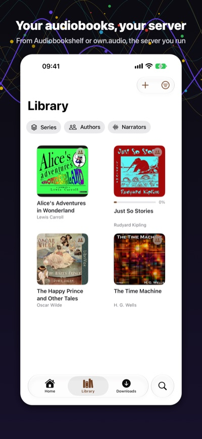
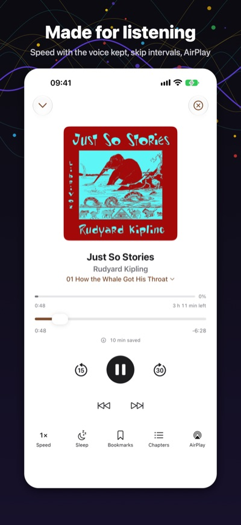
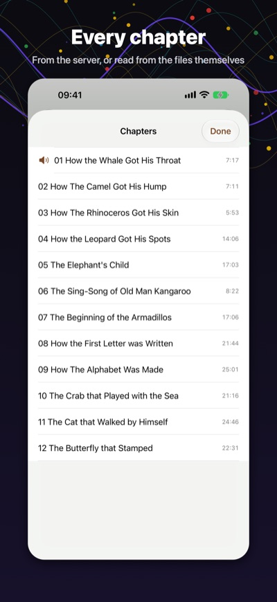
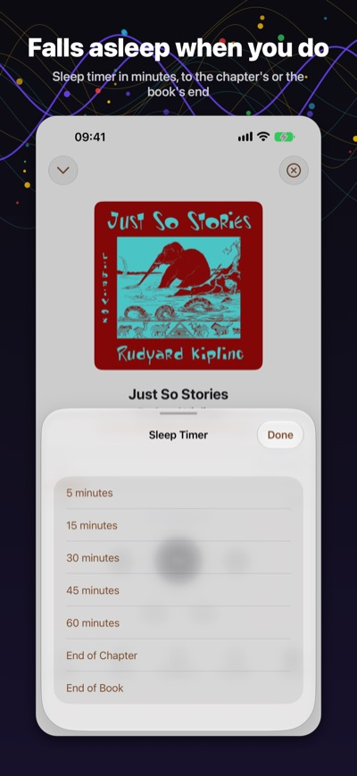

<p align="center">
  
</p>

<h1 align="center">own.audio Books</h1>

<p align="center">A native audiobook player for iPhone and iPad that plays from your own server.</p>

<p align="center">
  <a href="https://apps.apple.com/app/own-audio-books/id6823342558"></a>
</p>

<p align="center">
  <a href="https://apps.apple.com/app/own-audio-books/id6823342558">App Store</a> ·
  <a href="https://www.own.audio">Website</a> ·
  <a href="PRIVACY.md">Privacy</a> ·
  <a href="CHANGELOG.md">Changelog</a> ·
  <a href="https://github.com/own-audio/book-ios/issues">Report a problem</a>
</p>

<p align="center">
  
  
  
  
</p>

A native iPhone and iPad audiobook player for your own server: **own.audio and
Audiobookshelf**, side by side in one app. Swift and SwiftUI, no web views, no third-party
dependencies — a few megabytes.

Free on the App Store for iPhone and iPad since 12 November 2026; runs on iOS 18 and later.

## What it does

- Speed with pitch correction, chapters, skip buttons, smart rewind, sleep timer to the end of
  the chapter
- One position per book that follows you between devices; nothing is lost offline
- Chapters read from the file itself when the server has none
- Downloads and an offline mode: with no network it shows and plays what is on the phone
- Bookmarks, series, authors, narrators, collections — whatever the server offers
- Several servers at once; iPad; CarPlay (not yet tried in a car)
- With own.audio: a family library, importing books from the phone, a library on the phone
  that follows the server's changes
- English and Czech

## Why you can trust it

- **It collects nothing.** No account with us, no analytics, no ads, no tracking. The App
  Store privacy label says "Data Not Collected", and [PRIVACY.md](PRIVACY.md) lists the
  only places the app talks to: the servers you add, and Apple or Google if you sign in with
  them.
- **The code is all here.** Every line of the app is in this repository under the
  [MPL-2.0](LICENSE), with no third-party dependencies — only Apple's frameworks and the
  packages in `Packages/`. The App Store builds come from this repository with
  `scripts/testflight.sh`, and the build number is the commit count.
- **Your library stays yours.** The app plays from your server; your files are not copied
  anywhere else. Downloads stay on the phone and are removed with the app.
- **Free, with nothing to unlock.** No in-app purchases and no subscription. The only paid
  thing in own.audio is the optional hosted storage at [own.audio](https://www.own.audio),
  paid on the website.
- **Try it before you set anything up.** "Try the Demo Library" on the first screen signs
  in to a public demo server, no account needed.
- **Made by a person you can reach.** own.audio Books is built by
  [Kornel Maráz](https://www.own.audio/about/). Problems and questions go to
  [the issues](https://github.com/own-audio/book-ios/issues), or to hello@own.audio.

## Build

The plan is in [IMPLEMENTATION_PLAN.md](IMPLEMENTATION_PLAN.md).

Developed with Xcode 27 and [XcodeGen](https://github.com/yonaskolb/XcodeGen); runs on iOS 18
and later.

```bash
brew install xcodegen
xcodegen generate
open OwnAudioBooks.xcodeproj
```

## Layout

- `App/OwnAudioBooks/` — the app
- `Packages/AudiobookshelfKit/` — Audiobookshelf client
- `Packages/OwnAudioKit/` — own.audio client (`/api/v2`)
- `Packages/BookLibrary/` — one library model over both servers
- `Packages/PlayerEngine/` — the spoken-audio engine

## Privacy

The app collects nothing and talks only to the servers you add: [PRIVACY.md](PRIVACY.md).

## License

[MPL-2.0](LICENSE). Changes are listed in [CHANGELOG.md](CHANGELOG.md).
