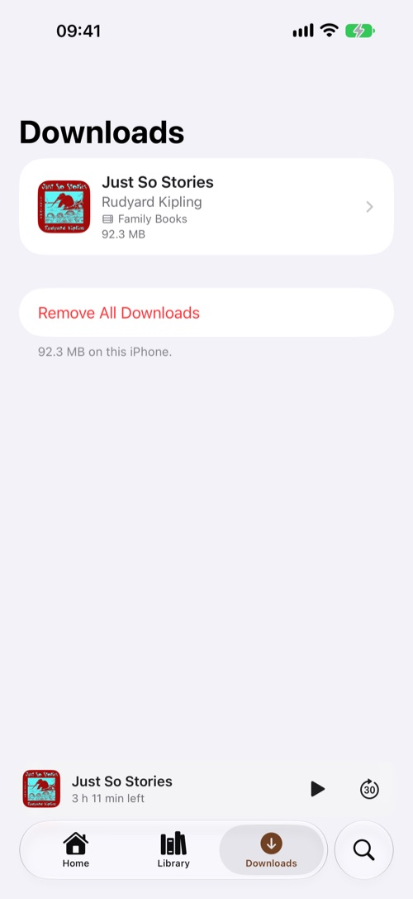

# Downloads and offline

## Downloading a book

Tap the download button beside **Play** on a [book's page](book.md#play-and-download), or the
download arrow on a series, an author's or narrator's list, or a collection to download every
book in it.

Downloads go on in the background, also when you leave the app, and pick up where they
stopped if they are interrupted. By default they wait for Wi-Fi (**Download on Wi-Fi Only** in
Settings).

Downloaded books are kept in the app's own storage on the iPhone, not in iCloud backups (they
can always be downloaded again). They are removed when you delete the app or remove their
server.

## The Downloads tab

**Downloads** lists what is on this iPhone, from every server, newest first. Each row shows the
cover, title, author, the server it came from and its size, or the download's progress.

{: width="300"}

- With more than one server, the books are grouped by server.
- While downloads run, **Downloading** shows how many. Failed ones can be tried again together
  with **Retry 3 Failed**.
- Swipe a book to **Remove** its download.
- **Remove All Downloads** removes them all, after asking. The total size is under it.

Settings also has a **Downloads** row with the total size, which opens the same list.

## Storage limit

**Keep at Most** in [Settings](settings.md#downloads-and-offline) sets a limit: **No Limit**
(the default), 1 GB, 2 GB, 5 GB or 10 GB. Over the limit, the app removes finished books first,
then the books not played for longest. It never removes the book that is playing.

## Offline mode

With no network, the app goes offline by itself. You can also turn **Offline Mode** on yourself,
with the Wi-Fi button at the top of [Home](home.md) or in Settings. Offline, the app asks
nothing of your servers and shows and plays only what is on the iPhone.

While offline, a line above the mini player says so: **No network · downloaded books only**, or
**Offline Mode · downloaded books only** when you turned it on. Then it has a **Turn Off**
button.

Your positions are saved on the iPhone while offline and sent to the server when you are back
online.

### The whole library offline (own.audio)

The app keeps a list of everything on an own.audio server, without the audio, so the library
can be browsed with no signal. With **Whole Library When Offline** on in Settings, the Library
shows the whole own.audio library when offline, with the books you haven't downloaded greyed
out. Only downloaded books play. The line above the mini player then says **only downloaded
books play**.

This setting appears only when you have an own.audio server. Audiobookshelf libraries show
only their downloads when offline.

## Mobile data

**On Mobile Data** in Settings decides what happens without Wi-Fi:

- **Original** (default): streams the original files.
- **Saver**: asks the server for a smaller stream (64 kbps, plenty for speech) where it makes
  one.
- **Downloaded Only**: on mobile data the app behaves as if offline and plays only what is on
  the iPhone.

## Keeping ahead while streaming

While a book streams, its next minutes are kept on the iPhone (mobile data too), so short gaps
in the signal go unheard. **Keep Ahead** in Settings sets how many: 5, 10 (default) or 15
minutes. With Low Data Mode on, it is 5 minutes. **Saver** streams are not kept ahead.
