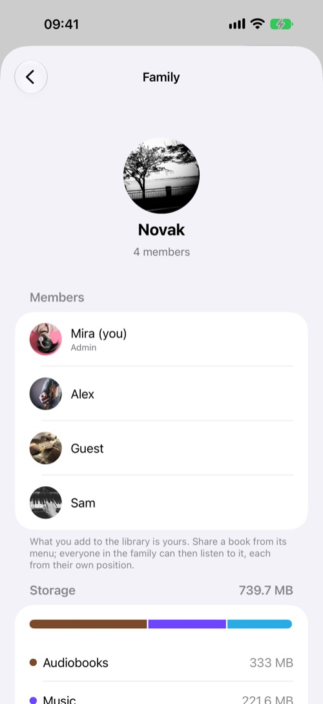

# Family (own.audio)

An own.audio account belongs to a family. Each member has their own books and positions, and
chooses which of their books to share with the others. Audiobookshelf has no families, so none
of this appears for an Audiobookshelf server.

## Sharing a book

What you add to the library is yours. To share one of your books, open its page, tap **⋯** and
choose **Share with the Family**. Everyone in the family can then listen to it, each from their
own position. **Keep to Myself** takes it back. You can only share books you added yourself.

Shared books have a people badge on their covers, and **Shared with the family** on their
page. When you import a book you can share it straight away (**Who sees it**: **The family**).

## The Family screen

Open **Settings**, tap your own.audio server, then **Family**. (It appears for the selected
server.)

{: width="300"}

- **Members**: everyone in the family, with **Admin** for the family's admin and **Invited**
  for someone who hasn't joined yet.
- **Storage**: how much the family's library takes, split into **Audiobooks**, **Music** and
  **Podcasts** (own.audio also has music and podcast apps).
- **Credit**: on a server that charges for storage, the family's **Balance**, **A Month at
  Today's Storage** and how long the credit **Lasts About**. Storage is paid from the family's
  prepaid credit, day by day; top-ups are not made in the app.
- **Invitations** (the admin only): **Invite Someone** makes a code for one person, shown with
  a QR code and a **Share Invitation** button. They sign in to the same server and enter the
  code, or open its link. Swipe an invitation to **Withdraw** it.
- **Join Another Family…**: enter a code from another family's admin. You then leave this
  family, and what the other family shares appears instead.

## Devices

On the server's page in Settings, **Devices** lists every device signed in to your account,
with **This device** marked and when each was last used. Swipe a device to **Sign Out**.
**Sign Out Everywhere** ends every session, this iPhone's too, and you sign in again.

## Listening

**Listening**, on the same page, shows what you have listened to in all own.audio apps signed in
to the account: choose **Week**, **Month**, **Year** or **All**.

- **Listened** (total time), **Days in a Row** and **Audiobooks Finished**
- a chart of minutes per day
- **By Kind**: audiobooks, music, podcasts
- **Most Played**

**Share with the Family's Admin** lets the admin see how long you listen, and to what kind; off,
your listening stays yours. The admin sees a **Family** section with the time of those who
share it, and **Private** for the others.
