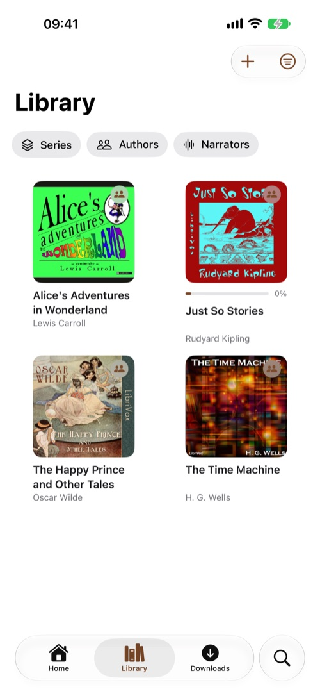
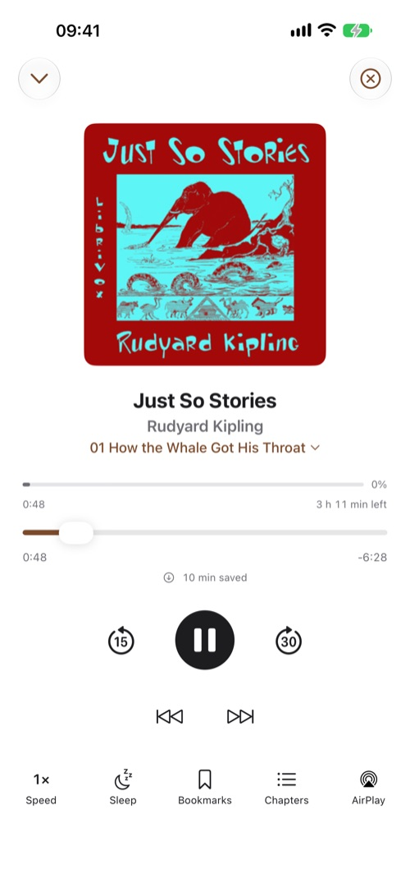
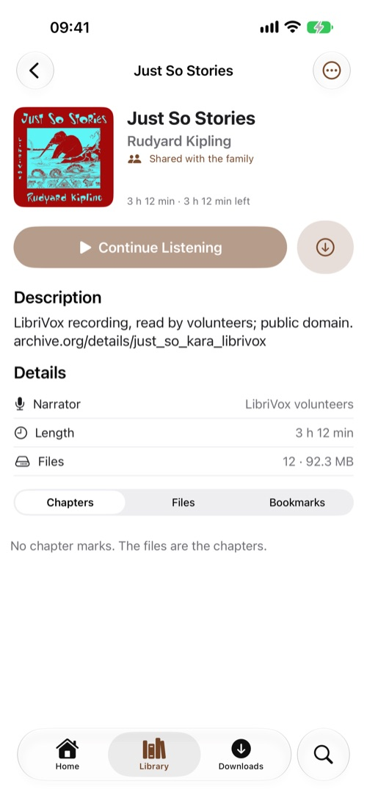
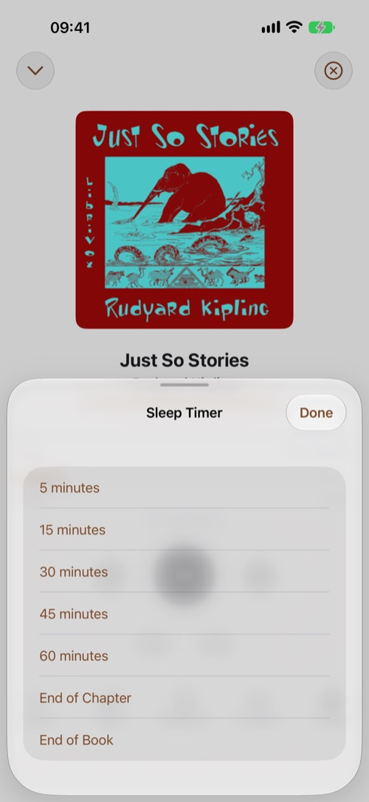

# own.audio Books

own.audio Books is an audiobook player for iPhone and iPad that plays from your own server. It
works with two kinds of server, side by side in one app:

- **Audiobookshelf**, the self-hosted audiobook server.
- **own.audio**, either a server you run yourself or the hosted service at
  [own.audio](https://www.own.audio).

The app has no account of its own and keeps no library of its own: it shows what is on the
servers you add. It is free, has no in-app purchases, and runs on iOS 18 and later. On the Home
Screen it is called **own.book**.

[Download on the App Store](https://apps.apple.com/app/own-audio-books/id6823342558){: .btn .btn-primary }

{: width="180"}
{: width="180"}
{: width="180"}
{: width="180"}

## What the two servers offer

The app asks each server what it can do and hides what the server doesn't have, so some
buttons only appear on one kind of server.

| Feature | own.audio | Audiobookshelf |
|---|---|---|
| Playing, chapters, speed, sleep timer | Yes | Yes |
| Bookmarks | Yes | Yes |
| Positions shared with your other devices | Yes | Yes |
| Asks which position to use when another device is ahead | Yes | No |
| Series, authors, narrators | Yes | Yes |
| Collections | No | Yes |
| Favourites | Yes | No |
| Several book libraries in one account | No | Yes |
| Smaller stream on mobile data (**Saver**) | Yes | Yes |
| Whole library browsable offline | Yes | No |
| Library updates within seconds of a change on the server | Yes | No |
| Importing books from the Files app | Yes | No |
| Family library and sharing | Yes | No |
| Signed-in devices, listening statistics | Yes | No |
| Sign in with Apple or Google, two-factor codes | Yes, if the server offers them | No |

## The guide

- [Getting started](getting-started.md): adding a server, the demo library, signing in.
- [Home](home.md): Continue Listening, the shelves and the mini player.
- [Library and search](library.md): all books, series, authors, narrators, collections.
- [A book's page](book.md): play, download, chapters, files, bookmarks, the book's menu.
- [The player](player.md): speed, skip buttons, smart rewind, chapters, bookmarks, sleep timer.
- [Downloads and offline](downloads.md): downloading, storage, offline mode, mobile data.
- [Adding books](importing.md): importing audio files to an own.audio server.
- [Family](family.md): the family library, devices and listening statistics on own.audio.
- [Servers](servers.md): a server's page, addresses, signing in again, removing a server.
- [Settings](settings.md): every setting, what it does and its default.
- [Outside the app](system.md): lock screen, Control Center, widgets, Siri, AirPlay, CarPlay.
- [iPad](ipad.md): the sidebar and what differs on iPad.
- [Privacy](privacy.md): what the app sends, and to whom.

## Links

- [own.audio Books on the App Store](https://apps.apple.com/app/own-audio-books/id6823342558)
- [Privacy policy](https://github.com/own-audio/book-ios/blob/main/PRIVACY.md)
- [Report a problem or ask a question](https://github.com/own-audio/book-ios/issues)
- [Source code](https://github.com/own-audio/book-ios) (MPL-2.0)

The app is in English and Czech; it follows your iPhone's language.
