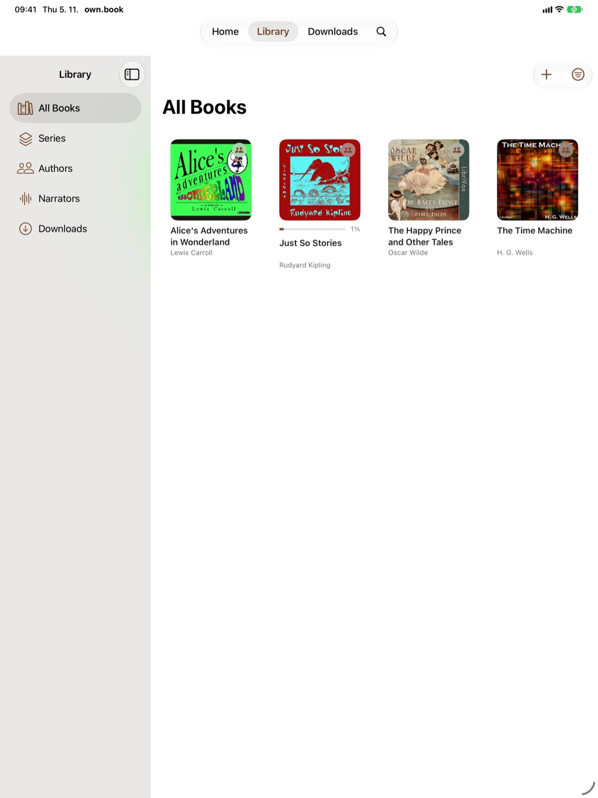

# iPad and Mac

The app works the same way on iPad, with the tabs at the top of the screen. It turns with the
iPad; on iPhone it stays upright.

## The Library sidebar

On iPad, the **Library** tab has a sidebar instead of the chips: **All Books**, **Series**,
**Authors**, **Narrators**, **Collections** (Audiobookshelf) and **Downloads**. The section you
pick opens beside it. The button at the top of the sidebar hides it.

{: width="600"}

In a narrow window, for example in Split View, the Library looks as it does on iPhone.

## Home and the player

Home and the player have the same layout as on iPhone, with more covers on each shelf.

{: width="600"}

{: width="600"}

## Keyboard

With a keyboard, on iPad or Mac:

| Key | What it does |
|---|---|
| Space | Play or pause |
| ⌘← | Skip back by your interval |
| ⌘→ | Skip forward by your interval |
| Esc | Close the full player |

Space and the arrows do nothing while you are typing in a text field.

## On a Mac

On a Mac with Apple silicon, the iPad app runs in a window. It works as on iPad, with these
differences:

- Where you would swipe a row on iPhone or iPad (a bookmark, a device, an invitation, an
  address, an import), right-click it instead.
- Settings has no **On Mobile Data** and no **Download on Wi-Fi Only**.
- **Choose Audio Files** in [Adding books](importing.md) opens the Mac's open panel.
- In **Devices** on own.audio, the Mac is listed as "Mac" after you sign in on it.
