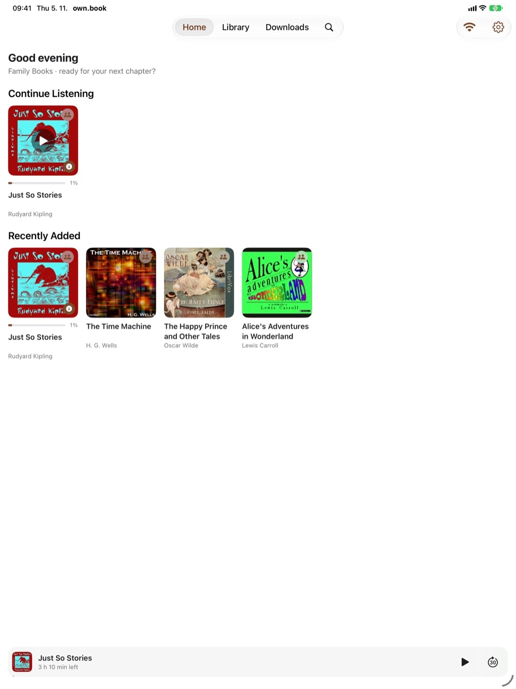
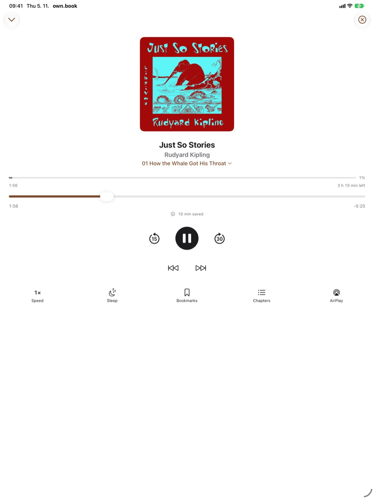

# iPad

The app works the same way on iPad, with the tabs at the top of the screen. It turns with the
iPad; on iPhone it stays upright.

## The Library sidebar

On iPad, the **Library** tab has a sidebar instead of the chips: **All Books**, **Series**,
**Authors**, **Narrators**, **Collections** (Audiobookshelf) and **Downloads**. The section you
pick opens beside it. The button at the top of the sidebar hides it.

{: width="600"}

In a narrow window, for example in Split View, the Library looks as it does on iPhone.

## Home and the player

Home and the player have the same layout as on iPhone, with more covers on each shelf.

{: width="600"}

{: width="600"}
