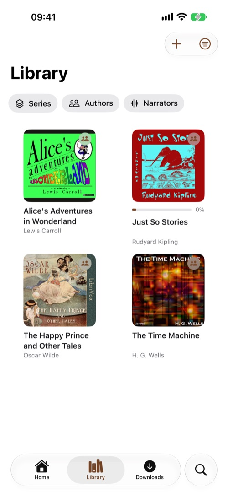

# Library and search

## The Library tab

**Library** shows every book on the selected server, as a grid of covers or as a list.

{: width="300"}

Above the books are chips to the other ways into the library. Only those the server has appear:

| Chip | own.audio | Audiobookshelf |
|---|---|---|
| **Series** | Yes | Yes |
| **Authors** | Yes | Yes |
| **Narrators** | Yes | Yes |
| **Collections** | No | Yes |

The list scrolls on as far as the library goes; more books load as you reach the end. Pull
down to reload.

### Sort and filter

The round button with lines at the top right opens a menu:

- **Sort**: **Title**, **Author**, **Recently Added** or **Length**, and **Descending** to
  reverse the order.
- **Show**: **All**, **Not Started**, **In Progress**, **Finished**, and on own.audio
  **Favourites**.
- **Grid**: on for covers, off for a list. In the list, each row shows the cover, title,
  author, and the length with the time left ("4 h 12 min · 1 h 3 min left") or **Finished**.
  The book that is playing has a small moving indicator.

### The + button (own.audio)

On an own.audio server, a **+** button at the top lets you add a book from your iPhone. See
[Adding books](importing.md). It is hidden on Audiobookshelf and while the app is offline.

## Series

**Series** lists the server's series with the number of books in each. A series opens its
books in reading order, each with its number in the series.

## Authors and narrators

**Authors** and **Narrators** list people with the number of their books. Type in the
**Filter** field at the top to find someone in a long list. A person opens their books, with the
same sort and filter menu as the library.

## Collections (Audiobookshelf)

**Collections** lists the collections made on your Audiobookshelf server, with the number of
books in each. A collection opens its books.

## Downloading a whole set

A series, an author's or narrator's books, and a collection have a download arrow at the top
right. It downloads every book in the set, including those you haven't scrolled to. While
they come, the arrow becomes a ring with the count downloaded so far; when all are on the
iPhone, it turns into a filled arrow with **Remove These Downloads** in its menu. See
[Downloads and offline](downloads.md).

## Search

The **Search** tab searches titles, authors, narrators and series. Type at least two letters;
the results come in sections: **Books**, **Series**, **Authors** and **Narrators**. A tap opens
the book, series or person.

On Audiobookshelf the server does the searching. On own.audio the app searches its copy of the
library on the iPhone. While offline, search finds downloaded books by title and author.
