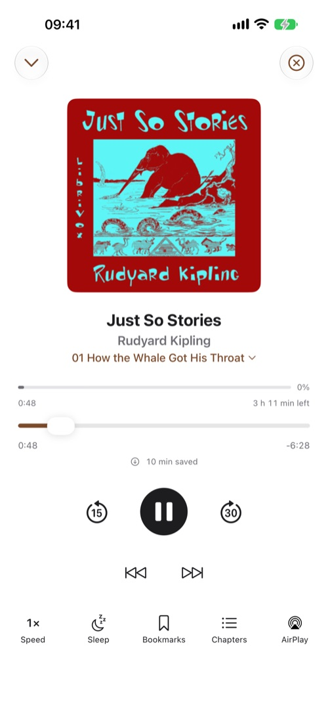
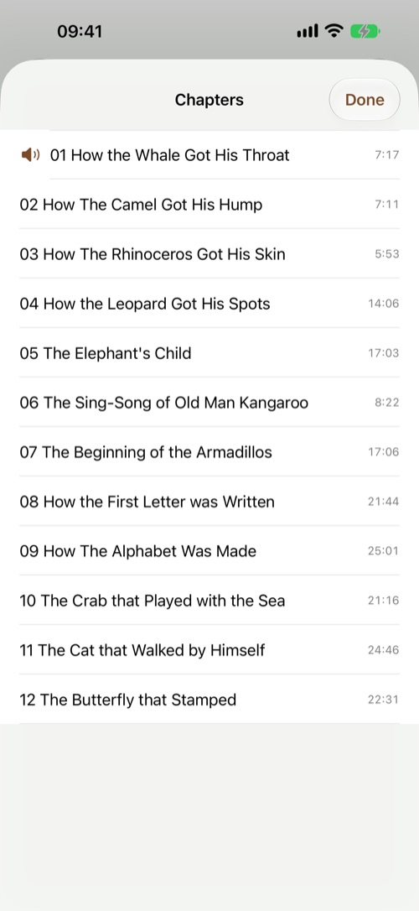
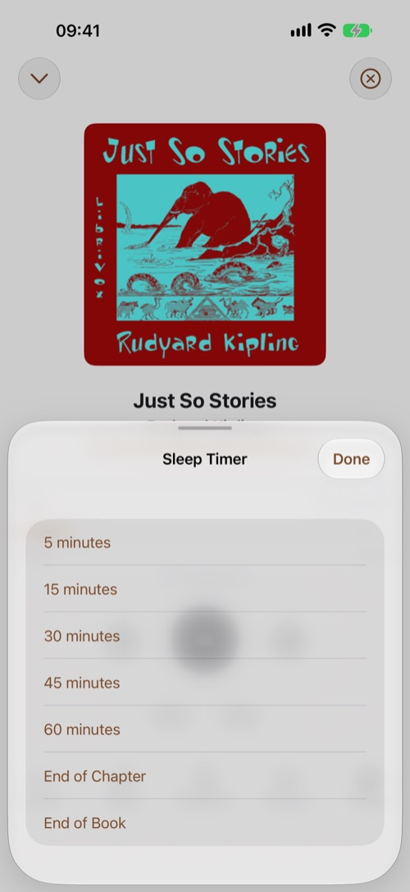

# The player

Tap the mini player at the bottom of the screen to open the full player.

{: width="300"}

## What's on it

From the top:

- **Close** (the down arrow, top left) hides the player; the book keeps playing in the mini
  player.
- **Stop** (the cross, top right) stops playback and closes the player.
- The cover, title and author. While the sleep timer runs, the cover shows how long is left
  in its corner.
- The current chapter's name. Tap it to open the chapter list.
- A thin bar for the **whole book**, with the percentage, the time played and the time left
  **at the current speed** ("3 h 11 min left").
- A slider for the **current chapter**, with the time into it and the time left in it. Drag it to
  move within the chapter.
- **"10 min saved"**: while a book streams, the app keeps the next minutes on the iPhone, so a
  tunnel or a gap in the signal goes unheard. This line says how much is kept. If the signal is
  gone for longer, it says **No signal — waiting** and plays on by itself when the signal returns.
- **Skip back** and **skip forward**, with play/pause between them. The numbers on the buttons
  are your intervals (15 and 30 seconds unless you change them in [Settings](settings.md)).
- **Previous chapter** and **next chapter**. On a book without chapter marks, they step by file.
- The tools: **Speed**, **Sleep**, **Bookmarks**, **Chapters** and **AirPlay**.

## Speed

Tap **Speed** (it shows the current speed, such as **1×**). The speed sheet has **–** and **+**
buttons that step by 0.05, and quick buttons for 0.75×, 1×, 1.25×, 1.5×, 1.75×, 2×, 2.5× and 3×.
The speed goes from 0.5× to 3×.

The voice keeps its pitch at any speed. Each book remembers its own speed; a book you haven't
played yet starts at **Speed for New Books** from Settings. The **Speed** tool is tinted when
the speed isn't 1×.

## Smart rewind

When you resume after a pause, the app goes back a little so you pick up the thread:

| Paused for | Goes back |
|---|---|
| under 10 seconds | nothing |
| under a minute | 3 seconds |
| under 10 minutes | 10 seconds |
| under an hour | 20 seconds |
| an hour or more | 30 seconds |

It is on by default; turn it off with **Smart Rewind** in [Settings](settings.md#playback).

## Chapters

**Chapters** (or a tap on the chapter's name) lists the book's chapters with their lengths; the
one playing has a speaker icon, and the list opens scrolled to it. Tap a chapter to play from
its start.

{: width="300"}

Chapters come from the server. When the server has none, the app reads the chapter marks
stored in the audio files; when there are none there either, each file is a chapter.

## Bookmarks

**Bookmarks** lists the bookmarks in this book. Tap **Add Bookmark at 12:34** to mark where you
are; you can give it a label or leave it empty. Tap a bookmark to play from there. Swipe one to
**Rename** or **Delete** it.

Bookmarks are kept on your server, so you see them on your other devices too. They need a
connection to the server.

## Sleep timer

**Sleep** opens the sleep timer:

{: width="300"}

- **5 minutes**, **15 minutes**, **30 minutes**, **45 minutes**, **60 minutes**
- **End of Chapter**: stops when the current chapter ends.
- **End of Book**

While a timer runs, the sheet shows **Stops in** with the time left, **Add 10 Minutes**, and
**Turn Off**. The **Sleep** tool is tinted while a timer is set.

## AirPlay

**AirPlay** opens the system's list of speakers and TVs to play to.

## Your position

The app saves your position on the iPhone first and then sends it to the server, so a lost
signal never loses your place; positions saved offline are sent when the connection returns.
That position follows you to your other devices and apps that use the same server.

Unplugging headphones pauses the book. A phone call pauses it, and it goes on afterwards when
iOS says it may.
